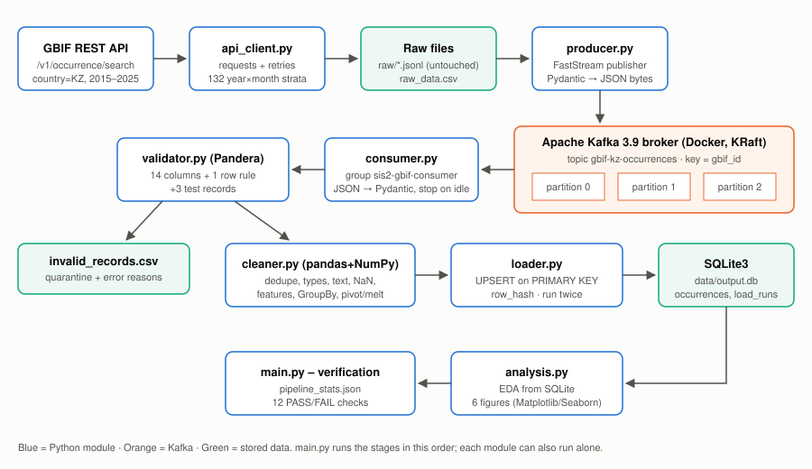
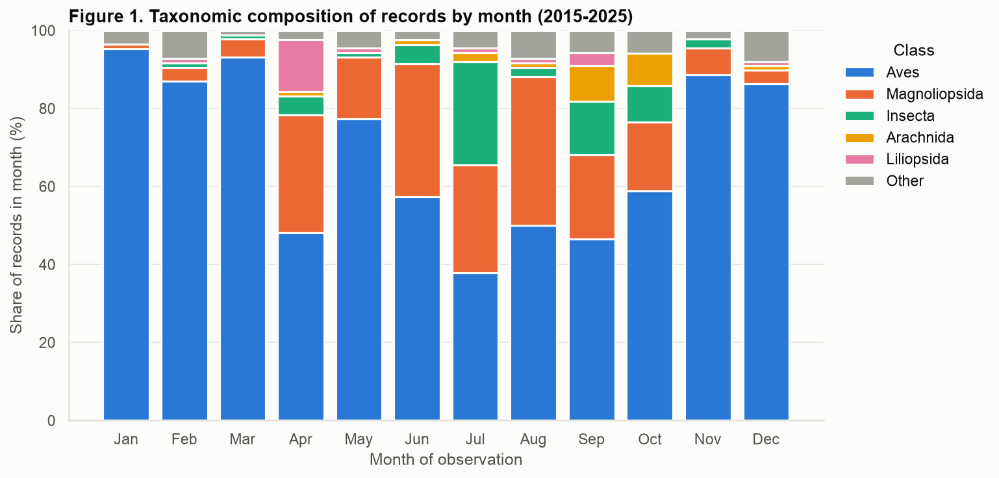
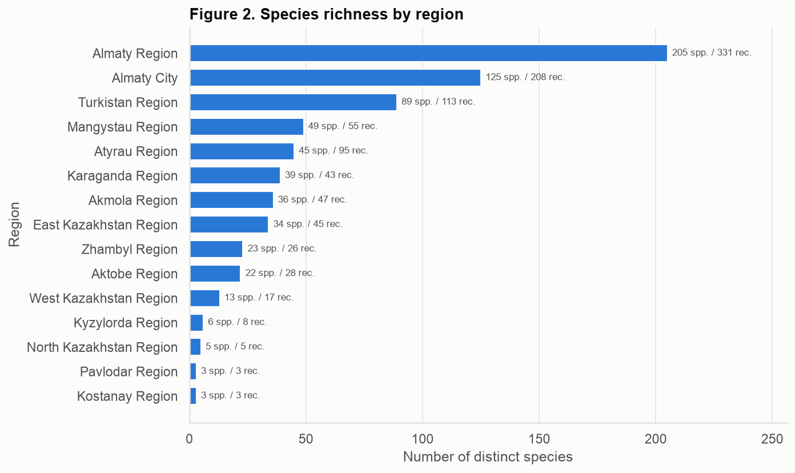
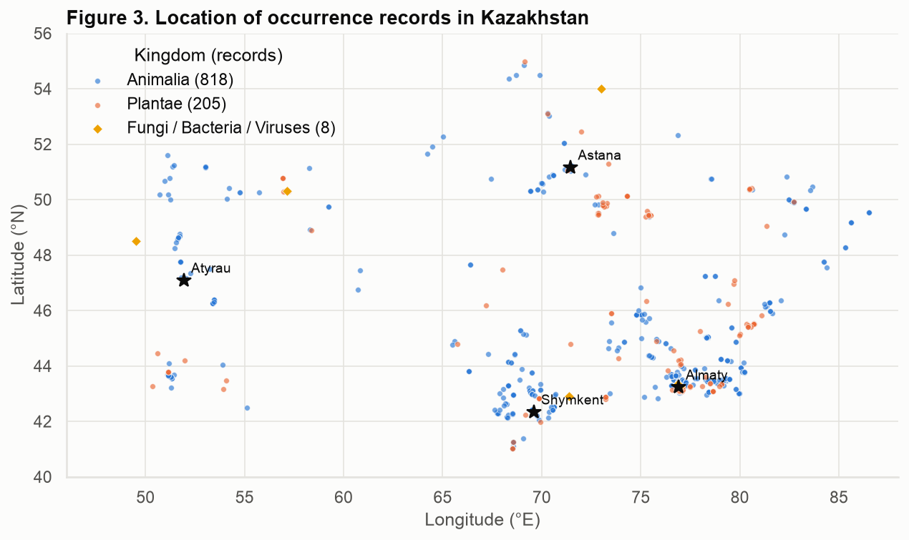
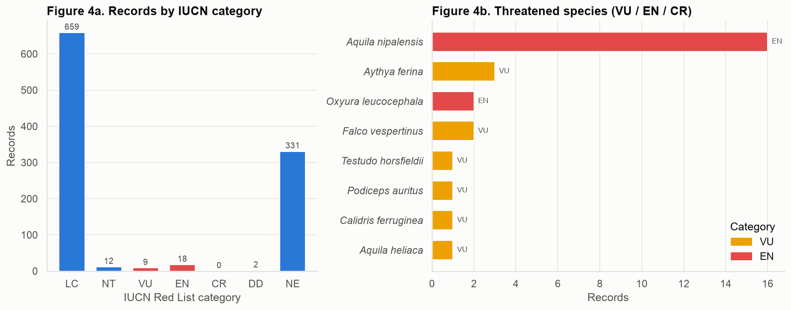
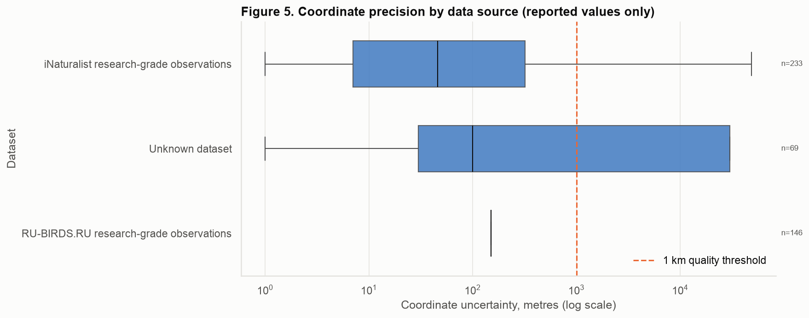
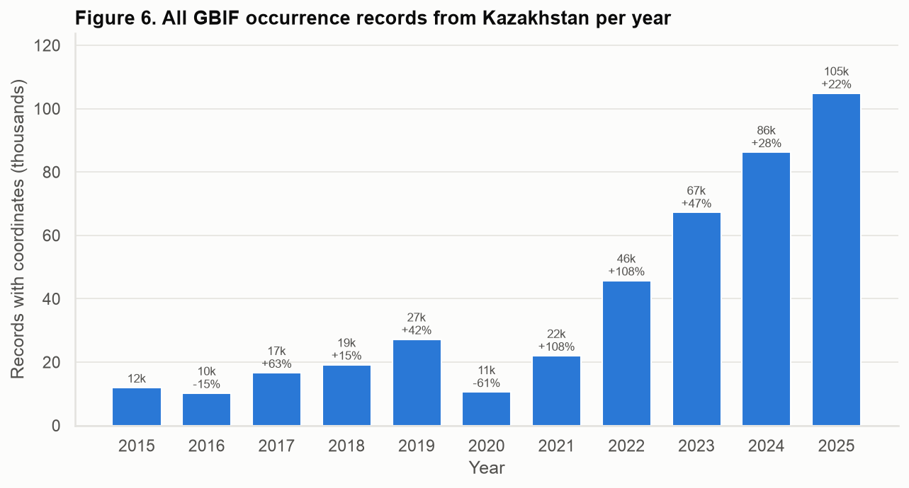

<div class="titlepage">

<p class="course">Data Collection &amp; Preparation — SIS2</p>

# Biodiversity of Kazakhstan: a Data Streaming and Validation Pipeline with Apache Kafka and Pandera {.unlisted .unnumbered}

<p class="subtitle">GBIF Occurrence API → Apache Kafka (FastStream) → Pandera → pandas / NumPy → SQLite3 → EDA</p>

| | |
|---|---|
| **Course** | Data Collection & Preparation |
| **Project** | SIS2 — Data Streaming and Validation Pipeline |
| **Group members** | Tamirlan Kustanaev; Li Stanislav |
| **Data source** | GBIF Occurrence API — <https://www.gbif.org/occurrence/search?country=KZ> |
| **Repository** | <https://github.com/wakeupkstnv/data-prep-sis-2> |
| **Submission date** | 24 November 2026 |

</div>

# 1. Introduction

## 1.1 Project background

The Global Biodiversity Information Facility (GBIF) is an international open-data network that combines species
observations from museums, herbaria, research projects and citizen-science platforms such as eBird and iNaturalist. For
Kazakhstan GBIF holds about 846 000 occurrence records. Each record says *which organism* was seen, *where* (coordinates),
*when*, *by which data source*, and carries quality information such as the coordinate uncertainty and the IUCN Red List
status of the species.

## 1.2 Problem description

GBIF data is real-world data and therefore messy. The same region is written in 36 different ways (English, Kazakh
transliteration, Russian transliteration and Cyrillic), 56 % of the records have no coordinate uncertainty, some
records lack the taxonomic name, and the same physical observation is sometimes published several times. Before such
data can be analysed it has to be collected reliably, transported, checked, cleaned and stored. The course asks us to
do this with a real streaming system (Apache Kafka) and a formal validation library (Pandera).

## 1.3 Objectives

1. Collect at least 200 real records from a public API with proper error handling and keep the raw data unchanged.
2. Stream every record through a real Apache Kafka broker with a Producer and a Consumer (JSON messages).
3. Validate the received data with a Pandera schema containing at least five meaningful rules and demonstrate it with
   deliberately invalid test records.
4. Clean and transform the data with pandas and NumPy (missing values, duplicates, types, text, GroupBy, reshaping).
5. Store the result in SQLite3 with a primary key so that repeated loading is idempotent.
6. Answer research questions about biodiversity in Kazakhstan with exploratory analysis and visualizations.
7. Verify that all stages are connected and that record counts are consistent.

## 1.4 Expected outcomes

A reproducible repository in which `python main.py` runs every stage, a clean SQLite database of about one thousand
occurrence records, six figures, and a verification report in which all consistency checks pass.

**Research questions.**
Q1 — Which taxonomic groups dominate the records and how does the composition change through the year?
Q2 — Where are the records concentrated and which regions have the highest species richness?
Q3 — Which threatened species (IUCN VU/EN/CR) appear in the data?
Q4 — How precise are coordinates from different data sources?
Q5 — How fast is the number of biodiversity records from Kazakhstan growing?

# 2. Data Source and Collection

## 2.1 API description and endpoint

| Item | Value |
|---|---|
| API | GBIF Occurrence Search API v1 (public, no key, JSON) |
| Endpoint | `GET https://api.gbif.org/v1/occurrence/search` |
| Documentation | <https://techdocs.gbif.org/en/openapi/v1/occurrence> |
| Maximum page size | 300 records; `offset + limit ≤ 100 000` |
| Implemented in | `src/api_client.py` |

## 2.2 Request parameters

| Parameter | Value | Purpose |
|---|---|---|
| `country` | `KZ` | only records from Kazakhstan |
| `hasCoordinate` | `true` | only records with latitude/longitude |
| `year` | 2015 … 2025 | one stratum per year |
| `month` | 1 … 12 | one stratum per month |
| `limit` | `0` (count query) or `8` | number of records in the page |
| `offset` | random, `< 3000` | start position of the page |
| `facet`, `facetLimit` | `month` / `year` | counts per month (for sampling) and per year (for Q5) |

## 2.3 Data collection procedure

A first naive version simply downloaded the first 100 records of each year. Profiling showed that GBIF returns results
in a date-like order, so almost all records were from January, which would make any seasonal analysis meaningless.
The final procedure is therefore a **stratified random sample**:

1. For every year 2015–2025 a facet request (`limit=0&facet=month`) returns the number of KZ records in each month.
2. For each of the 132 (year, month) strata a random offset below `min(count, 3000)` is drawn with a fixed seed (42), so
   the sample is reproducible. Deep offsets are very slow on GBIF (a test request with offset 61 240 took ~37 s), so offsets are kept below 3 000.
3. One page of 8 records is downloaded per stratum. The 132 requests run in 4 parallel threads.
4. A facet query per year stores the total number of records for Q5.
5. The untouched JSON records are written to `data/raw/gbif_raw_records.jsonl`; a flattened copy with 28 columns goes
   to `data/raw_data.csv`. Later stages never modify these files.

**Error handling** (`get_json`):

```python
for attempt in range(1, settings.gbif_max_retries + 1):
    try:
        resp = session.get(settings.gbif_base_url, params=params, timeout=settings.gbif_timeout_s)
        if resp.status_code == 200:
            return resp.json()
        if resp.status_code == 429 or resp.status_code >= 500:     # temporary -> retry
            last_error = GBIFRequestError(f"HTTP {resp.status_code}: {resp.text[:200]}")
        else:                                                         # 4xx -> fail fast
            raise GBIFRequestError(f"HTTP {resp.status_code} for {params}: {resp.text[:200]}")
    except (requests.ConnectionError, requests.Timeout) as exc:
        last_error = exc
    except ValueError as exc:                                         # body is not JSON
        last_error = GBIFRequestError(f"Invalid JSON response: {exc}")
    time.sleep(2 ** attempt)                                          # exponential back-off
```

If one stratum still fails it is logged and skipped (`failed_strata`), so a single bad request does not stop the run.
Records that do not fit the Pydantic `OccurrenceRecord` model (e.g. no `gbifID`) are counted as malformed.

## 2.4 Dataset size and structure

| Measure | Value |
|---|---|
| Strata (year × month) | 132 |
| Records collected | **1 053** (3 strata returned fewer than 8 records) |
| Failed strata / malformed records | 0 / 0 |
| Columns in `raw_data.csv` | 28 |
| Period | 1 Jan 2015 – 31 Dec 2025 |
| Records per month | 87–88 (equal by design) |

## 2.5 Numerical, categorical and date/time fields

| Type | Fields |
|---|---|
| Numerical | `latitude`, `longitude`, `coord_uncertainty_m`, `individual_count`, `issue_count`, `media_count` |
| Categorical | `kingdom`, `phylum`, `taxon_class`, `taxon_order`, `family`, `genus`, `species`, `taxon_rank`, `basis_of_record`, `iucn_category`, `state_province`, `dataset_name`, `institution_code`, `license` |
| Date/time | `event_date`, `year`, `month`, `day`, `last_interpreted` |
| Identifier | `gbif_id` |

The full description of every column is in `docs/data_dictionary.md`.

## 2.6 Examples of collected records

| gbif_id | species | class | basis | state_province | lat | lon | uncertainty | event_date | dataset |
|---|---|---|---|---|---|---|---|---|---|
| 1946332321 | Accipiter nisus | Aves | HUMAN_OBS. | Almaty | 43.666 | 76.568 | — | 2015-01-01T00:00 | iNaturalist |
| 1914072271 | — | — | HUMAN_OBS. | Almatinskaya oblasty | 45.027 | 78.325 | 30 | 2016-02-04 | — |
| 4093012982 | Amygdalus nana | Magnoliopsida | PRESERVED_SPEC. | — | 48.887 | 58.371 | 100 | 2015-08-16 | — |

The second row has no taxonomy at all and is later rejected by Pandera; the third belongs to a group of four identical
herbarium specimens that the cleaner identifies as duplicates.

# 3. Pipeline Architecture

## 3.1 Architecture diagram



## 3.2 Components

| # | Module | Input | Output | Responsibility |
|---|---|---|---|---|
| 1 | `src/api_client.py` | GBIF API | `raw/gbif_raw_records.jsonl`, `raw_data.csv` | sampling, HTTP requests, retries, raw storage |
| – | `src/config.py`, `src/models.py` | `.env` / env vars | `settings`, Pydantic models | typed configuration and message contract |
| 2a | `src/producer.py` | raw JSONL | Kafka topic | create topic, wrap records in `KafkaEnvelope`, publish |
| 2b | `src/consumer.py` | Kafka topic | `consumed_records.csv` | subscribe, deserialize, reject bad messages, commit |
| 3 | `src/validator.py` | `consumed_records.csv` | `validated_records.csv`, `invalid_records.csv` | Pandera schema, test records, quarantine |
| 4 | `src/cleaner.py` | `validated_records.csv` | `processed_records.csv`, `summaries/` | missing values, duplicates, types, text, NumPy, GroupBy, reshaping |
| 5 | `src/loader.py` | `processed_records.csv` | `output.db` | schema, idempotent UPSERT, SQL verification |
| 6 | `src/analysis.py` | `output.db` | `figures/`, `eda_summary.txt` | descriptive statistics, grouped analysis, figures |
| 7 | `main.py` | `pipeline_stats.json`, DB | `pipeline_verification.txt` | runs all stages, compares counts |

## 3.3 Data flow and interaction

The stages are connected only through their real outputs: the producer reads the file written by the collector, the
validator reads exactly what the consumer received from Kafka, the loader reads the cleaner's output, and the analysis
reads the SQLite database — not an intermediate CSV. Every stage also writes its counts to `data/pipeline_stats.json`,
which stage 7 uses to compare the numbers. `main.py` calls the stages in order, but each module is also a standalone
script (`python -m src.<module>`), so the producer and consumer can run in two separate terminals.

# 4. Apache Kafka Implementation

## 4.1 Broker configuration

A real single-node Apache Kafka 3.9.1 broker runs in Docker (`docker-compose.yml`) in KRaft mode (no ZooKeeper).

| Setting | Value | Reason |
|---|---|---|
| `KAFKA_PROCESS_ROLES` | `broker,controller` | one node acts as both |
| `KAFKA_ADVERTISED_LISTENERS` | `PLAINTEXT://localhost:9092` | clients on the host connect here |
| `KAFKA_AUTO_CREATE_TOPICS_ENABLE` | `false` | topics must be created explicitly by our code |
| `KAFKA_OFFSETS_TOPIC_REPLICATION_FACTOR` | `1` | single broker |
| healthcheck | `kafka-broker-api-versions.sh` | `docker compose ps` shows *healthy* when ready |

## 4.2 Topic configuration

| Property | Value |
|---|---|
| Name | `gbif-kz-occurrences` |
| Partitions | 3 |
| Replication factor | 1 |
| `retention.ms` | 7 days |
| Message key | `gbif_id` → the same record always goes to the same partition |

The topic is created with the aiokafka admin client in `src/kafka_admin.py` (`create`, `describe`, `reset`).
`main.py` resets the topic before each full run so that the run is one clean, finite stream.

## 4.3 Library choice: FastStream + Pydantic

The first prototype used `confluent-kafka`. After discussion in the group we switched to **FastStream** (on top of the
`aiokafka` client) because it integrates **Pydantic**: the message is a typed model and FastStream does JSON
serialization and validation automatically. Pydantic checks only *structure and types* of a message; business rules
(coordinate ranges, allowed categories, dates) stay in Pandera, so the two libraries have clear and different roles.

```python
class KafkaEnvelope(BaseModel):                # src/models.py
    model_config = ConfigDict(extra="forbid")
    run_id: str = Field(min_length=1)
    seq: int = Field(ge=1)
    source: Literal["gbif-occurrence-api"] = "gbif-occurrence-api"
    produced_at: datetime
    record: OccurrenceRecord                   # 28 typed fields, built from GBIF camelCase aliases
```

`OccurrenceRecord` uses `AliasChoices("gbifID", "gbif_id")`, so the same model reads the raw GBIF JSON (camelCase) and
the messages (snake_case).

## 4.4 Producer

```python
broker = KafkaBroker(settings.kafka_bootstrap_servers, client_id="sis2-gbif-producer",
                     acks="all",               # wait until the broker has persisted the message
                     enable_idempotence=True,  # internal retries cannot create duplicates
                     linger_ms=20)
publisher = broker.publisher(settings.kafka_topic)
...
results = await asyncio.gather(
    *(publisher.publish(env, key=str(env.record.gbif_id).encode()) for env in chunk),
    return_exceptions=True)
for env, res in zip(chunk, results):
    if isinstance(res, Exception): failed += 1          # delivery error
    else: delivered += 1; per_partition[res.partition] += 1
```

`publish()` returns the broker's `RecordMetadata` (partition, offset) only after the acknowledgement, so
*delivered* really means "stored by Kafka". Messages are sent in chunks of 100 concurrent requests.

## 4.5 Consumer

```python
@broker.subscriber(settings.kafka_topic, group_id=group_id, auto_offset_reset="earliest",
                   ack_policy=AckPolicy.MANUAL)
async def handle(envelope: KafkaEnvelope, msg: KafkaMessage) -> None:
    # envelope is already deserialized from JSON and validated by Pydantic here
    record = envelope.record.model_dump()
    record["kafka_partition"] = msg.raw_message.partition
    record["kafka_offset"] = msg.raw_message.offset
    rows.append(record)
```

**Termination condition.** The stream is finite, so the consumer stops when no message arrives for
`KAFKA_CONSUMER_IDLE_TIMEOUT_S` = 10 s (or after `--max-messages`). Then it writes `consumed_records.csv` and only
*after that* commits the offsets (`AckPolicy.MANUAL` + `msg.ack()`), giving at-least-once delivery: if the program
crashes before saving, the messages are read again next time. Because the committed offset is stored in Kafka, a
second run of the consumer reads **0** new messages.

## 4.6 JSON serialization and deserialization

* **Serialization (producer):** FastStream calls Pydantic `model_dump_json()` on `KafkaEnvelope` and sends UTF-8 JSON
  bytes with header `content-type: application/json`. `datetime` values become ISO strings, `None` becomes `null`.
* **Deserialization (consumer):** the bytes are parsed as JSON and validated against `KafkaEnvelope` before the handler
  is called. A real message read with Kafka's own console consumer:

```text
Partition:0  Offset:0  key=1946332321
{"run_id":"b6c3ec801b62","seq":3,"source":"gbif-occurrence-api","produced_at":"2026-11-24T12:01:37.589320Z",
 "record":{"gbif_id":1946332321,"scientific_name":"Accipiter nisus (Linnaeus, 1758)","species":"Accipiter nisus",
 "kingdom":"Animalia",...,"latitude":43.666497,"longitude":76.56784,"coord_uncertainty_m":null,
 "event_date":"2015-01-01T00:00","year":2015,"month":1,"day":1,...,"issue_count":2,"media_count":0}}
```

## 4.7 Error handling

| Situation | Handling |
|---|---|
| Broker not reachable | admin/producer/consumer raise `ConnectionError` with a clear message, script exits with code 1 |
| Topic missing | producer creates it; consumer stops with "run the producer first" |
| Delivery failure | `gather(..., return_exceptions=True)` → counted in `messages_failed`, exit code 2 |
| Raw line not valid | skipped and counted as `malformed_raw_lines` |
| Message not JSON / breaks contract | `ExceptionMiddleware` catches `ValidationError`, counts it, the offset is still committed so a "poison" message is not read forever |

To *demonstrate* the consumer error handling, `main.py` runs the producer with `--inject-invalid 3`, which sends three
broken messages as raw bytes: `this is not JSON`, an envelope without `gbif_id`, and one with `seq=0` and
`produced_at="yesterday"`. All three were rejected:

```text
consumer WARNING Rejected message that violates the KafkaEnvelope contract: Input should be a valid dictionary or instance of KafkaEnvelope
consumer WARNING Rejected message that violates the KafkaEnvelope contract: Input should be greater than or equal to 1
consumer WARNING Rejected message that violates the KafkaEnvelope contract: Input should be a valid datetime or date, input is too short
```

## 4.8 Message transmission results

```text
published: 1053 (+3 broken demo), failed: 0, per partition: {'0': 310, '1': 367, '2': 376}
consumed: 1053, rejected: 3
topic state: {'partitions': {0: {'end_offset': 310, 'committed': 310, 'lag': 0},
                             1: {'end_offset': 367, 'committed': 367, 'lag': 0},
                             2: {'end_offset': 379, 'committed': 379, 'lag': 0}}, 'messages_in_topic': 1056}
```

| Metric | Value |
|---|---|
| Messages published (valid records) | 1 053 |
| Broken demo messages | 3 |
| Messages in topic (sum of end offsets) | 1 056 |
| Messages consumed and deserialized | 1 053 |
| Messages rejected by the consumer | 3 |
| Consumer lag after the run | 0 on all partitions |

This is the evidence that Producer → Topic → Consumer communication works: every published record arrived, the
broker stores 1 056 messages across 3 partitions, and the consumer group has committed all of them.

# 5. Pandera Validation

## 5.1 Validation schema

The schema (`build_schema()` in `src/validator.py`) is applied to `consumed_records.csv` — the data exactly as received
from Kafka — *before* cleaning. It runs in lazy mode (`schema.validate(df, lazy=True)`), so all failures of all rows are
collected in one pass.

```python
pa.DataFrameSchema(
    columns={
        "gbif_id":   pa.Column("int64", pa.Check.gt(0), nullable=False, coerce=True),
        "scientific_name": pa.Column(str, pa.Check.str_length(min_value=3), nullable=False),
        "kingdom":   pa.Column(str, pa.Check.isin(ALLOWED_KINGDOMS), nullable=False),
        "basis_of_record": pa.Column(str, pa.Check.isin(ALLOWED_BASIS), nullable=False),
        "taxon_rank":    pa.Column(str, pa.Check.isin(ALLOWED_RANKS), nullable=True),
        "iucn_category": pa.Column(str, pa.Check.isin(ALLOWED_IUCN), nullable=True),
        "latitude":  pa.Column(float, pa.Check.in_range(40.5, 55.5), nullable=False, coerce=True),
        "longitude": pa.Column(float, pa.Check.in_range(46.4, 87.4), nullable=False, coerce=True),
        "coord_uncertainty_m": pa.Column(float, pa.Check.in_range(0, 50_000), nullable=True, coerce=True),
        "individual_count":    pa.Column(float, pa.Check.in_range(1, 10_000), nullable=True, coerce=True),
        "year":  pa.Column("Int64", pa.Check.in_range(1900, CURRENT_YEAR), coerce=True),
        "month": pa.Column("Int64", pa.Check.in_range(1, 12), nullable=True, coerce=True),
        "day":   pa.Column("Int64", pa.Check.in_range(1, 31), nullable=True, coerce=True),
        "event_date": pa.Column(str, [pa.Check(_event_date_parseable), pa.Check(_event_date_not_in_future)]),
    },
    checks=[pa.Check(_year_matches_event_date, error="year does not match event_date")],
    strict=False)
```

## 5.2 Validation rules

| # | Rule | Type | Why it matters |
|---|---|---|---|
| R1 | `gbif_id` is an integer, not null, > 0 | data type, identifier | the database primary key |
| R2 | `scientific_name` not null, ≥ 3 characters | required field | a record without a taxon is useless |
| R3 | `kingdom`, `basis_of_record`, `taxon_rank`, `iucn_category` in allowed lists | categorical values | catches typos/unknown codes |
| R4 | latitude 40.5–55.5, longitude 46.4–87.4 | numeric range | the point must be inside Kazakhstan |
| R5 | coordinate uncertainty 0–50 000 m | numeric range | > 50 km cannot be placed in a region |
| R6 | individual count 1–10 000; numeric types coerce | range + type | negative/zero/text counts are errors |
| R7 | year 1900–current, month 1–12, day 1–31 | date parts | impossible dates |
| R8 | `event_date` is a valid ISO date (ranges `a/b` allowed) and not in the future | date/time, custom | GBIF mixes date formats |
| R9 | `year` equals the year of `event_date` | custom cross-column (DataFrame-level) | internal consistency |

Missing values in *optional* columns (uncertainty, count, region, dataset) are allowed here on purpose and handled
in the cleaning stage — they do not make the observation wrong.

## 5.3 Test records

Because the real data contained only one invalid record, three deliberately invalid test records were added
(`make_test_records()`). They are marked with negative `gbif_id`, `dataset_name = "SIS2_VALIDATION_TEST"` and
`is_test_record = True`.

| Test id | What was broken | Errors detected by Pandera |
|---|---|---|
| −1 | lat 95, lon 10, kingdom "Aliens", uncertainty −5, year ≠ event_date | `gbif_id must be positive`; `latitude outside Kazakhstan`; `longitude outside Kazakhstan`; `kingdom: isin(...)`; `uncertainty must be 0..50000 m`; `<row>: year does not match event_date` |
| −2 | no scientific name, basis "GUESS", date 2999-01-01, month 13 | `gbif_id must be positive`; `scientific_name: not_nullable`; `basis_of_record: isin(...)`; `event_date is in the future`; `year: in_range(1900, 2026)`; `month: in_range(1, 12)` |
| −3 | event_date "not-a-date", year 1700, individual_count "many", IUCN "XX" | `gbif_id must be positive`; `event_date is not a valid ISO date`; `year: in_range`; `individual_count: coerce_dtype('float64')`; `iucn_category: isin(...)` |

Every rule fired at least once. Extract from `data/validation_errors.csv`:

```text
index,column,check,failure_case,gbif_id,is_test_record
1053,<row>,year does not match event_date,year=2012,-1,True
1055,individual_count,coerce_dtype('float64'),many,-3,True
1055,iucn_category,"isin(['LC', 'NT', 'VU', 'EN', 'CR', 'EW', 'EX', 'DD', 'NE'])",XX,-3,True
38,scientific_name,not_nullable,,1914072271,False
38,kingdom,not_nullable,,1914072271,False
```

## 5.4 Handling strategy

* **Quarantine, do not repair.** Invalid rows are written to `data/invalid_records.csv` together with a
  `validation_errors` column listing every failed rule; the pipeline continues with the valid rows. We do not guess a
  missing taxon or move a point into Kazakhstan, because that would invent data.
* **Test records never pass on.** They fail the schema anyway, and as a safety net the validator additionally drops
  every row with `is_test_record = True` from the valid output. The final check confirms that no row with a negative id
  or the test dataset name exists in the database.

## 5.5 Validation results

| Result | Count |
|---|---|
| Records received from Kafka | 1 053 |
| Test records added | 3 |
| Rows validated | 1 056 |
| **Valid records** | **1 052** |
| **Invalid real records** | **1** (`gbif_id` 1914072271: no `scientific_name`, no `kingdom`) |
| Invalid test records detected | 3 of 3 |
| Total rule failures | 20 |

# 6. Data Cleaning and Transformation

All steps are in `src/cleaner.py` and run on the 1 052 valid records.

## 6.1 Missing-value analysis

| Column | Missing | % | Handling | Reason |
|---|---|---|---|---|
| `coord_uncertainty_m` | 587 | 55.8 | median of the same `basis_of_record`, flag `uncertainty_imputed` | eBird never reports it; the flag lets analysis exclude imputed values |
| `individual_count` | 505 | 48.0 | 1, flag `count_imputed` | a presence record means at least one individual |
| `institution_code` | 239 | 22.7 | `"Unknown"` | descriptive only |
| `state_province` | 137 | 13.0 | region of the nearest labelled record ≤ 50 km (NumPy), else `"Unknown"` | 129 filled, 4 remain Unknown |
| `dataset_name` | 102 | 9.7 | `"Unknown dataset"` | descriptive only |
| `species` | 10 | 1.0 | `"<Genus> sp."`, flag `identified_to_species` | identified only to genus |
| `taxon_order`, `family`, `genus`, `taxon_class` | 1–8 | < 1 | `"Unknown"` | keep the record |
| `day` | 8 | 0.8 | day of the parsed `event_date` | date known with month precision |
| `iucn_category` | 0 after validation | – | `NE` (Not Evaluated) if missing | official IUCN code |

After cleaning there are **0** missing values in the analysed columns.

## 6.2 Duplicate detection and removal

1. **Exact duplicates** — the same `gbif_id` (e.g. if a topic is replayed): 0 found in this run.
2. **Same-observation duplicates** — the same taxon at the same coordinates (rounded to 4 decimals ≈ 11 m) on the same
   day. 35 rows formed such groups, mainly herbarium duplicate sheets (four identical *Amygdalus nana* specimens from
   16 Aug 2015) and the same observation uploaded to two platforms. The copy with the smallest coordinate uncertainty
   (then most photos) is kept: **21 rows removed**. The groups are saved in `summaries/duplicate_groups.csv`.

## 6.3 Data type conversion

`gbif_id` → `int64`; `event_date` → `datetime64` (ranges `a/b` → start date, mixed ISO formats parsed with
`format="ISO8601"`); `year/month/day/individual_count/issue_count/media_count` → nullable `Int64`;
coordinates → `float64`; `last_interpreted` → UTC datetime; 10 low-cardinality text columns → `category`
(kingdom, class, basis, rank, IUCN, region, region source, season, precision class, licence).

## 6.4 Text standardization and normalization

* All text: `strip()` and collapse repeated spaces; taxonomy in title case; codes in upper case.
* Licence URL → short code (`CC-BY`, `CC-BY-NC`, `OTHER`) with a regular expression.
* **Region names:** accents are removed with Unicode NFKD (`Ongtüstik` → `ongtustik`), the text is lower-cased and
  matched against 20 regular expressions covering English, Kazakh and Russian transliterations and Cyrillic
  (`Мангистауская область` → *Mangystau Region*, `Ongtüstik Qazaqstan oblysy` and `South Kazakhstan` →
  *Turkistan Region*). **36 raw spellings → 15 regions + Unknown.**
* Publishers write "Almaty" for both the city and the oblast (points up to 496 km from the city). The city is
  therefore separated geometrically: any Almaty label within 20 km of the city centre → *Almaty City*.

| Raw spellings (records) | Canonical region |
|---|---|
| Aqtöbe (19), Aktyubinskaya oblasty (5), Актюбинская область (4) | Aktobe Region |
| Shyghys Qazaqstan oblysy (12), East Kazakhstan (22), Vostochno-Kazahstanskaya oblasty (10), East Kazakhstan region (1) | East Kazakhstan Region |
| Mangghystau oblysy (40), Mangghystau (8), Мангистауская область (7) | Mangystau Region |
| Ongtüstik Qazaqstan oblysy (71), South Kazakhstan (32) | Turkistan Region |

## 6.5 NumPy operations

```python
def haversine_km(lat1, lon1, lat2, lon2):
    lat1, lon1, lat2, lon2 = map(np.radians, (lat1, lon1, lat2, lon2))
    a = np.sin((lat2 - lat1) / 2) ** 2 + np.cos(lat1) * np.cos(lat2) * np.sin((lon2 - lon1) / 2) ** 2
    return 2 * EARTH_RADIUS_KM * np.arcsin(np.sqrt(a))
```

* Vectorised **haversine distances** to the centre of Kazakhstan, Almaty and Astana.
* **Nearest-neighbour region fill:** a 133 × 898 distance matrix (records without region × records with region) via broadcasting (`[:, None]` vs `[None, :]`),
  `argmin(axis=1)` finds the closest labelled record.
* `np.log10(uncertainty + 1)` for the skewed uncertainty (skewness 5.5).
* `np.select` for **season**, `np.where` for **precision class**, `np.isin` for **is_threatened**.
* Cyclic encoding `np.sin / np.cos(2π · day_of_year / 365.25)` and a **z-score** of the distance to Almaty.

## 6.6 Filtering with multiple conditions

| Filter | Records |
|---|---|
| threatened **and** uncertainty ≤ 1 km **and** year ≥ 2020 | 7 |
| class Aves **and** season Summer **and** > 300 km from Almaty | 64 |
| kingdom Plantae **and** has a photo **and** high quality | 168 |

`is_high_quality` itself is a combined condition: uncertainty ≤ 1 km **and** ≤ 3 GBIF issues **and** identified to species.

## 6.7 GroupBy and aggregation

```python
df.groupby("taxon_class").agg(records=("gbif_id", "count"), species=("species", "nunique"),
                              threatened=("is_threatened", "sum"),
                              median_uncertainty_m=("coord_uncertainty_m", "median"),
                              mean_dist_almaty_km=("dist_almaty_km", "mean"))
```

| Class | Records | Species | Threatened | Median uncertainty, m | Mean distance to Almaty, km |
|---|---|---|---|---|---|
| Aves (birds) | 712 | 214 | 26 | 150 | 699 |
| Magnoliopsida (flowering plants) | 174 | 134 | 0 | 150 | 480 |
| Insecta | 58 | 51 | 0 | 96 | 495 |
| Arachnida | 21 | 18 | 0 | 150 | 218 |
| Liliopsida | 19 | 14 | 0 | 122 | 722 |
| Mammalia | 13 | 10 | 0 | 30 | 715 |

A second aggregation by region (records, species, kingdoms, threatened share, first/last year) is in
`summaries/groupby_region.csv`, and `groupby(["year", "basis_of_record"]).size().unstack()` gives a year × source table.

## 6.8 Reshaping

* `pivot_table(index="season", columns="kingdom", aggfunc="count")`:

| Season | Animalia | Bacteria | Fungi | Plantae | Viruses |
|---|---|---|---|---|---|
| Winter | 241 | 5 | 0 | 12 | 0 |
| Spring | 203 | 0 | 0 | 56 | 0 |
| Summer | 160 | 0 | 0 | 93 | 0 |
| Autumn | 214 | 0 | 2 | 44 | 1 |

* `pivot_table(index="month", columns="taxon_class")` for the five largest classes, then **`melt()`** back to long
  (tidy) format `month, taxon_class, records` for plotting.
* `crosstab(region, season)` followed by **`stack()`** → long table `region, season, records`; **`unstack()`** for
  the year × basis-of-record table.

## 6.9 Result

**1 052 → 1 031 records, 43 columns, 0 missing values.** Every operation has a concrete reason: duplicates would
inflate species counts, the 36 region spellings would split one region into many groups, wrong types would break
sorting and date logic, and the NumPy features (distance, season, precision) are needed for the research questions.

# 7. SQLite3 Database Implementation

## 7.1 Schema

`sql/schema.sql` creates two tables. Main table (abridged):

```sql
CREATE TABLE IF NOT EXISTS occurrences (
    gbif_id             INTEGER PRIMARY KEY,
    scientific_name     TEXT    NOT NULL,
    species             TEXT    NOT NULL,
    kingdom             TEXT    NOT NULL,
    iucn_category       TEXT    NOT NULL CHECK (iucn_category IN ('LC','NT','VU','EN','CR','EW','EX','DD','NE')),
    is_threatened       INTEGER NOT NULL CHECK (is_threatened IN (0, 1)),
    region              TEXT    NOT NULL,
    latitude            REAL    NOT NULL CHECK (latitude  BETWEEN 40.5 AND 55.5),
    longitude           REAL    NOT NULL CHECK (longitude BETWEEN 46.4 AND 87.4),
    coord_uncertainty_m REAL    NOT NULL CHECK (coord_uncertainty_m >= 0),
    event_date          TEXT    NOT NULL,          -- ISO 8601 YYYY-MM-DD
    month               INTEGER NOT NULL CHECK (month BETWEEN 1 AND 12),
    season              TEXT    NOT NULL CHECK (season IN ('Winter','Spring','Summer','Autumn')),
    ...                                            -- 43 data columns in total
    row_hash            TEXT    NOT NULL,          -- SHA-256 of the business columns
    first_loaded_at     TEXT    NOT NULL,
    last_updated_at     TEXT    NOT NULL);
CREATE UNIQUE INDEX IF NOT EXISTS ux_occurrence_observation
    ON occurrences (scientific_name, latitude, longitude, event_date);
CREATE TABLE IF NOT EXISTS load_runs (run_id INTEGER PRIMARY KEY AUTOINCREMENT, started_at TEXT, source_file TEXT,
    rows_in_file INTEGER, inserted INTEGER, updated INTEGER, unchanged INTEGER, rows_in_table INTEGER);
```

Booleans are stored as `INTEGER 0/1` with CHECK constraints; dates as ISO text (SQLite has no date type).
Indexes on `taxon_class`, `region` and `event_date` support the typical queries.

## 7.2 Primary key and uniqueness

* `gbif_id INTEGER PRIMARY KEY` — the natural key from GBIF.
* `UNIQUE (scientific_name, latitude, longitude, event_date)` — the same observation cannot be stored twice under
  different ids (the database-level guarantee for the cleaner's de-duplication).

## 7.3 Insertion process

```python
upsert_sql = (f"INSERT INTO occurrences ({cols}) VALUES ({placeholders}) "
              f"ON CONFLICT(gbif_id) DO UPDATE SET {col = excluded.col, ...} "
              f"WHERE occurrences.row_hash <> excluded.row_hash")
with conn:                                   # one transaction: commit or rollback
    conn.executemany(upsert_sql, df.itertuples(index=False, name=None))
    conn.execute("INSERT INTO load_runs (...) VALUES (...)", ...)
```

Each row gets a deterministic SHA-256 `row_hash` of its content. New ids are **inserted**; an existing id with a
different hash is **updated**; an existing id with the same hash is **left untouched** (not even the timestamp
changes). The whole run is one transaction.

## 7.4 Verification queries and results

All queries are in `sql/verification_queries.sql` and are run by the loader:

| Query | Result |
|---|---|
| `SELECT COUNT(*) FROM occurrences` | 1 031 |
| duplicate primary keys (`GROUP BY gbif_id HAVING COUNT(*) > 1`) | 0 rows |
| duplicate observations (name, lat, lon, date) | 0 rows |
| NULLs in name / latitude / date / region | 0 / 0 / 0 / 0 |
| date range | 2015-01-01 … 2025-12-31 |
| coordinate range | lat 41.03–55.00, lon 49.52–86.50 |
| records per year | 80–96 per year (2015 is lower: 3 strata returned fewer records and 13 of the 21 removed duplicates were 2015 herbarium sheets) |

```text
-- rows_by_kingdom
 kingdom  records  species
Animalia      818      300
 Plantae      205      153
Bacteria        5        5
   Fungi        2        2
 Viruses        1        1
-- threatened_species
            species iucn_category  records  regions
  Aquila nipalensis            EN       16  East Kazakhstan, Aktobe, Almaty Region, Turkistan, Atyrau, Zhambyl
      Aythya ferina            VU        3  Almaty Region, Mangystau, Turkistan
  Falco vespertinus            VU        2  West Kazakhstan, Akmola
Oxyura leucocephala            EN        2  Almaty Region, Turkistan Region
```

## 7.5 Stored records and idempotency test

`loader.idempotency_test()` runs the loading stage twice with the same file and compares a fingerprint
(SHA-256 of all `gbif_id, row_hash, last_updated_at`) of the table after each run. The value itself differs between
pipeline runs because it contains the load timestamp; what matters is that run 1 and run 2 give the same value.

```text
=== IDEMPOTENCY TEST ===
run 1: {'rows_in_file': 1031, 'inserted': 1031, 'updated': 0, 'unchanged': 0,    'rows_in_table': 1031}
run 2: {'rows_in_file': 1031, 'inserted': 0,    'updated': 0, 'unchanged': 1031, 'rows_in_table': 1031}
table fingerprint run 1 = cddea814dc23d807, run 2 = cddea814dc23d807
RESULT: PASSED - no duplicates, no changes
processed records: 1031 | stored in SQLite: 1031 | MATCH
```

| run_id | rows_in_file | inserted | updated | unchanged | rows_in_table |
|---|---|---|---|---|---|
| 1 | 1 031 | 1 031 | 0 | 0 | 1 031 |
| 2 | 1 031 | 0 | 0 | 1 031 | 1 031 |

The second execution created no duplicates and changed nothing — the stored data is identical.

# 8. Exploratory Data Analysis

The analysis (`src/analysis.py`) reads the data from `data/output.db`.

## 8.1 Dimensions, types and descriptive statistics

1 031 rows × 46 columns (43 data + 3 metadata); types: 14 text, 10 float, 8 integer, 8 category, 5 boolean, 1 datetime.

| Variable | Mean | Std | Min | Median | Max | Skew |
|---|---|---|---|---|---|---|
| latitude | 45.22 | 2.83 | 41.03 | 43.67 | 55.00 | 1.09 |
| longitude | 71.36 | 9.72 | 49.52 | 76.62 | 86.50 | −1.14 |
| coord_uncertainty_m | 1 163 | 5 369 | 1 | 150 | 48 736 | 5.51 |
| individual_count | 8.9 | 100.6 | 1 | 1 | 3 000 | 26.7 |
| dist_almaty_km | 642 | 709 | 0.6 | 335 | 2 185 | 0.99 |
| issue_count | 3.03 | 0.88 | 0 | 3 | 6 | −0.50 |

The median latitude (43.7) and longitude (76.6) are close to Almaty: half of all records come from the south-east.
Uncertainty and individual counts are extremely right-skewed (a few flocks of up to 3 000 birds).

## 8.2 Categorical statistics

| Variable | Distinct | Most frequent | Share |
|---|---|---|---|
| kingdom | 5 | Animalia | 79.3 % |
| taxon_class | 16 | Aves | 69.1 % |
| basis_of_record | 4 | HUMAN_OBSERVATION | 97.2 % |
| iucn_category | 6 | LC | 63.9 % (NE 32.1 %) |
| region | 16 | Almaty Region | 32.1 % |
| dataset_name | 4 | eBird | 44.1 % |
| species / families / orders | 461 / 151 / 69 | | |

Precision classes: 18.1 % high (≤ 100 m), 76.9 % medium (≤ 1 km), 4.9 % low (> 1 km).

## 8.3 Grouped analysis

Share of kingdoms per season (%): Animalia 93.4 → 78.4 → 63.2 → 82.0 and Plantae 4.7 → 21.6 → 36.8 → 16.9 from
winter to autumn. Share of high-quality records: birds 50 %, flowering plants 93 %, insects 86 % — bird records more often
carry several GBIF issue flags. Correlation analysis: the distance to Almaty correlates strongly with longitude
(r = −0.91), while coordinate uncertainty is unrelated to location (|r| ≤ 0.03).

## 8.4 Visualizations



**Figure 1 (Q1).** Because the sample contains the same number of records for every month, the bars show the real
composition. Birds make up 86–95 % of records from November to March, when insects and plants are inactive and
wintering water-birds are counted. From April the share of flowering plants (orange) rises, insects peak in July
(26 %), and arachnids appear in September–October. Biodiversity recording in Kazakhstan is strongly seasonal and
bird-dominated.



**Figure 2 (Q2).** Almaty Region (205 species) and Almaty City (125) together hold more than half of all records.
Turkistan, Mangystau and Atyrau follow. Northern and central regions (Kostanay, Pavlodar, North Kazakhstan) have only
3–5 species — this reflects where observers live, not where biodiversity is low.



**Figure 3 (Q2).** Records cluster around Almaty and the Tien Shan foothills, Shymkent, the Caspian coast near Atyrau
and the Altai in the east, while the central steppe and deserts are almost empty. Plants are concentrated around Almaty
and Karaganda.



**Figure 4 (Q3).** 64 % of records are *Least Concern* and 32 % have no IUCN assessment (mostly plants and insects).
27 records (2.6 %) belong to 8 threatened species — all birds plus the Central Asian tortoise *Testudo horsfieldii*.
The Steppe Eagle *Aquila nipalensis* (Endangered) is the most frequent with 16 records in six regions, which shows
Kazakhstan's importance for this species.



**Figure 5 (Q4).** Only reported (not imputed) uncertainties are plotted. iNaturalist has a median of 46 m (GPS of
phones), while records without a dataset name (mostly museum and herbarium specimens) range up to tens of kilometres.
RU-BIRDS always reports exactly 150 m (a fixed default, not a measurement), and eBird reports no uncertainty at all, which
is why it is missing from the plot. Uncertainty therefore depends on the data source, which justifies the
`uncertainty_imputed` flag.



**Figure 6 (Q5).** The total number of KZ records with coordinates grew from 12 000 (2015) to 105 000 (2025) — almost
nine times. The only drop is 2020 (−61 %, COVID-19 restrictions); since 2021 growth has been 22–108 % per year, driven
by citizen-science platforms.

## 8.5 Main findings

1. Birds dominate (69 % of records, 214 species), but plants and insects form a large share in summer.
2. Records are geographically very uneven — over half are from the Almaty area; central and northern Kazakhstan are
   under-sampled.
3. 8 threatened species were found; the Endangered Steppe Eagle is the most widespread.
4. Coordinate quality depends on the platform; 95 % of records are precise to ≤ 1 km.
5. Biodiversity data from Kazakhstan grows quickly (~9× in ten years), mostly from citizen science.

# 9. Pipeline Testing and Verification

## 9.1 Record counts of every stage

Output of stage 7 (`data/summaries/pipeline_verification.txt`):

```text
1. Records collected from GBIF API                  1053
2. Messages published to Kafka (valid records)      1053
   + deliberately broken demo messages                 3
3. Messages consumed and deserialized               1053
   rejected by consumer (bad JSON / contract)          3
4. Pandera: valid records                           1052
   Pandera: invalid real records (quarantined)         1
   Pandera: invalid TEST records detected              3
5. Records after cleaning                           1031
   duplicates removed by cleaner                      21
6. Records stored in SQLite                         1031
```

## 9.2 Explanation of the differences

* **1 053 → 1 053 (Kafka):** no loss. The 3 extra messages were broken on purpose and rejected by the consumer.
* **1 053 → 1 052 (Pandera):** one real record (`gbif_id` 1914072271) has no scientific name and no kingdom → quarantined.
  The 3 test records were also rejected and never left the validator.
* **1 052 → 1 031 (cleaning):** 21 records were second copies of the same observation (same taxon, place and day).
* **1 031 → 1 031 (SQLite):** every cleaned record is stored exactly once.

## 9.3 Consistency checks

```text
[PASS] collected == published
[PASS] published == consumed
[PASS] broken demo messages all rejected
[PASS] consumed == valid + invalid real
[PASS] all test records detected
[PASS] valid - duplicates == cleaned
[PASS] cleaned == stored
[PASS] DB ids == processed ids
[PASS] DB ids subset of raw API ids
[PASS] no test records in DB
[PASS] no duplicate keys in DB
[PASS] second load inserted/updated nothing
Pipeline finished in 12s - verification PASS
```

`DB ids ⊆ raw API ids` proves that every stored row comes from the API (no manually prepared data), and
`DB ids == processed ids` proves that the database contains exactly the expected records.

## 9.4 Repeated execution

* Loading stage twice → 0 inserted, 0 updated, identical fingerprint (section 7.5).
* Consumer run a second time without new messages → `messages_consumed: 0` because the offsets are committed.
* `python main.py` executed several times → same counts (fixed sampling seed) and PASS every time.

## 9.5 Encountered errors and how they were handled

| Problem | Solution |
|---|---|
| First sample contained almost only January records (GBIF result order) | stratified year × month sampling with random offsets |
| Deep offsets (e.g. 61 240) took ~37 s per request and exceeded the timeout | offsets limited to < 3 000; 4 parallel threads → collection in < 1 min |
| Consumer group remembered old offsets from tests | `kafka_admin reset` / `main.py` resets the topic for a clean finite stream |
| Rejected "poison" messages were re-read on every run | the error handler also commits the offset of the rejected message |
| A DataFrame-level Pandera check was reported once per column (36 duplicates) | collapsed to one `<row>` failure per record |
| One non-numeric value made a whole column fail coercion, hiding range errors of other rows | test records arranged so that each rule can be observed; documented behaviour |
| "Almaty" used for both city and oblast | geometric split (≤ 20 km from the city centre) |
| SQLite returns booleans as 0/1 | cast back to `bool` when reading for the analysis |
| `numpy 2.5` requires Python ≥ 3.12 | `requires-python = ">=3.12"` in `pyproject.toml` |

# 10. Conclusions

## 10.1 Implemented functionality

A complete pipeline was built and runs with one command: stratified API collection with retries and raw-data
preservation; a real Kafka broker in Docker with an explicitly configured 3-partition topic; a FastStream producer and
consumer with Pydantic JSON contracts, manual offset commits, a finite-stream stop condition and error handling; a
Pandera schema with nine rule groups plus three test records; pandas/NumPy cleaning with documented reasons; an idempotent
SQLite UPSERT with hash-based change detection; an EDA with six figures; and an automatic verification with twelve
consistency checks.

## 10.2 Main analytical findings

Biodiversity records from Kazakhstan are dominated by birds, follow a clear seasonal cycle, are concentrated around
Almaty, include eight threatened species (most often the Endangered Steppe Eagle) and have grown about nine-fold in ten
years.

## 10.3 Technical challenges and solutions

The main challenges were representative sampling from an API with a fixed result order and slow deep paging, making the
Kafka stream finite and safely re-runnable (offset commits after saving, topic reset), separating message-level
validation (Pydantic) from dataset-level validation (Pandera), and normalizing multilingual region names.

## 10.4 Limitations

* The sample has an equal number of records per month by design, so it shows *composition*, not absolute seasonal
  activity; total yearly volumes come from the GBIF facet query instead.
* GBIF is a live database; re-running later can return slightly different records.
* 56 % of coordinate uncertainties are imputed; they are flagged, but analyses using this column must respect the flag.
* Records reflect observer effort (cities, roads), not the true distribution of species.
* The Kafka setup is a single broker without replication or security — sufficient for a course project, not for production.

# 11. Individual Contributions

The group members are Tamirlan Kustanaev and Li Stanislav. Individual responsibilities should be documented after
the team confirms its actual division of work; the repository alone does not establish who completed each component.

# 12. References

1. GBIF.org — Occurrence search, Kazakhstan. <https://www.gbif.org/occurrence/search?country=KZ>
2. GBIF Technical Documentation — Occurrence API. <https://techdocs.gbif.org/en/openapi/v1/occurrence>
3. GBIF data citation: GBIF.org (2026), *GBIF Occurrence Download/Search*, records accessed 24 Nov 2026 via the API.
4. Apache Kafka Documentation. <https://kafka.apache.org/documentation/>
5. Apache Kafka Docker image. <https://hub.docker.com/r/apache/kafka>
6. FastStream Documentation — Kafka. <https://faststream.ag2.ai/latest/kafka/>
7. aiokafka Documentation. <https://aiokafka.readthedocs.io/>
8. Pydantic Documentation. <https://docs.pydantic.dev/> and pydantic-settings <https://docs.pydantic.dev/latest/concepts/pydantic_settings/>
9. Pandera Documentation. <https://pandera.readthedocs.io/>
10. pandas Documentation. <https://pandas.pydata.org/docs/>
11. NumPy Documentation. <https://numpy.org/doc/>
12. SQLite — UPSERT. <https://www.sqlite.org/lang_upsert.html>
13. Matplotlib <https://matplotlib.org/> and Seaborn <https://seaborn.pydata.org/> documentation.
14. IUCN Red List Categories and Criteria. <https://www.iucnredlist.org/>
